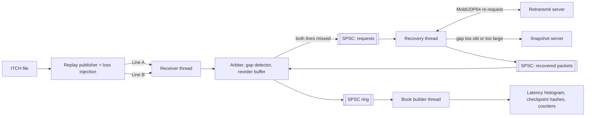

# ITCH Feed Handler Version 2 Plan (Stage C)

Version 1 (Stages A and B, tagged `v1.0`) reads NASDAQ ITCH from a file,
moves messages through an SPSC ring, rebuilds an aggregated book, and proves
correctness against a deliberately simple **golden model** after every
message. Version 2 moves the same pipeline onto a real network path. Packets
arrive over UDP on two redundant lines, packets get lost and recovered, and
the book still comes out identical to the file replay. Then the receive path
moves from kernel sockets to kernel bypass.

The finish line is one results table with real numbers, a timestamp source
on every row, and a pass on every correctness check.

---

## 1. Version 2 targets

| Area | Version 1 | Version 2 target | Stage |
|---|---|---|---|
| Book | aggregated price levels (sorted vectors) | order level, FIFO queue position at every level, price-indexed levels near the touch | C0 |
| Hot-path allocations | possible (level vectors grow, order map can rehash) | none, proven by an allocation counter that reads zero after warmup | C0 |
| Input | memory-mapped file | the same file packed into MoldUDP64 packets by a replay publisher | C1 |
| Transport | none | UDP on two redundant lines A and B: multicast on one host, unicast between two AWS hosts | C1, C2 |
| Line arbitration | none | first copy of each sequence number wins; duplicates and overlaps dropped | C2 |
| Receive path | none | kernel sockets with `recvmmsg`, then AF_XDP, then DPDK (time-boxed). Same arbitration and recovery code on every path | C2, C4 |
| Gap handling | impossible (a file has none) | fill from the other line, then retransmit request, then snapshot resync; tested with seeded loss | C3 |
| Latency | parser stamp → book updated | receive timestamp → book updated (wire to book), hardware stamp if available, else labelled software stamp | C2, C4 |
| Correctness | golden model after every message | same book hash as the file replay at every checkpoint, over the network, including after recovery | C0 onward |
| Results | Stage A/B tables | p50, p99, p99.9, max per path, plus pass/fail on book match after loss | C4 |

---

## 2. Architecture



**Threads on the receiving host**

| Thread | Core | Job |
|---|---|---|
| Receiver | pinned, isolated | busy-polls both lines, stamps packets, arbitrates, detects gaps, pushes messages into the SPSC ring |
| Book builder | pinned, isolated, a different physical core | pops messages, updates the book, records wire-to-book latency, computes checkpoint hashes |
| Recovery | not pinned | sends retransmit or snapshot requests, hands recovered packets back to the receiver through a second SPSC ring |

One receiver thread polls both lines and arbitrates inline, so arbitration is
single-threaded: no locks and no extra queue hop. Recovery runs on its own
thread so a slow retransmit never stalls the fast path. All queues are the
Version 1 `SpscQueue`.

**Hosts**

| Host | Runs |
|---|---|
| Publisher host | replay publisher, retransmit server, snapshot server |
| Receiver host | receiver, book builder, recovery thread |

On one Linux host, both roles run in two network namespaces joined by a veth
pair (see C2).

---

## 3. Repo layout

The Version 1 layout stays; Version 2 adds directories beside it rather than
moving code that Stages A and B depend on.

| Path | Contents | Status |
|---|---|---|
| `include/fh/parser/` | ITCH parser, message struct, mmap | Version 1 |
| `include/fh/book/` | golden and fast aggregated books; **new** `fifo_book.hpp` (order level), `golden_fifo_book.hpp` (its reference), `pool.hpp`, `fixed_hash_map.hpp`, order-level hash | C0 |
| `include/fh/queue/` | SPSC ring and Stage B baselines | Version 1 |
| `include/fh/stats/` | clock, histogram, report; **new** `alloc_counter.hpp` | C0 |
| `include/fh/mold/` | MoldUDP64 encoder and decoder | C1 |
| `include/fh/net/` | receive paths behind one interface (`recvmmsg`, AF_XDP, DPDK) | C2, C4 |
| `include/fh/arb/` | arbiter, gap detector, reorder buffer | C2, C3 |
| `include/fh/recovery/` | retransmit client and server, snapshot client and server | C3 |
| `tools/` | `itch_publisher`, `golden_hashes` (checkpoint hashes from the file replay) | C0, C1 |
| `tests/`, `bench/`, `docs/` | as in Version 1, extended per stage | all |

The common receive interface is the key design choice. Every transport
delivers the same thing, so everything after it is shared code and the
latency comparison is fair:

```cpp
enum class TsSource : uint8_t { Hardware, KernelSoftware, UserPoll };

struct RxPacket {
    const uint8_t* data;
    uint32_t len;
    uint8_t line;        // 0 = A, 1 = B
    uint64_t rx_ns;      // on the clock the book thread also reads (see C2)
    TsSource ts_source;
};

class RxPath {
public:
    virtual ~RxPath() = default;
    virtual int poll(RxPacket* out, int max) = 0;  // never allocates
    virtual void release(int count) = 0;           // returns buffers to the ring
};
```

The virtual call is once per *batch* of packets, not per message.

---

## 4. Stage C0. Order-level book and allocation proof

Everything here is **new work**: Version 1's book aggregates levels and
uses sorted vectors, and its hash cannot see queue order.

### Order-level FIFO book

Every price level holds its orders in arrival order, so "how many shares sit
ahead of order X" can be answered at any moment.

| Structure | Choice | Why |
|---|---|---|
| Order lookup | preallocated open-addressing map, reference → order slot. **Fixed capacity: overflow is a counted error, never a rehash** | constant time, no allocation |
| Order storage | fixed pool of order nodes with a free list | adding an order never calls `new` |
| Level contents | intrusive doubly linked list of orders, head = first in queue; level keeps total shares and count | O(1) cancel and delete from the middle |
| Levels near the touch | per stock and side, a **price-indexed window** of level handles (one slot per tick) with a **bitset** for best-price search | O(1) lookup where nearly all activity happens |
| Levels far from the touch | a pool-backed ordered tree (treap) per stock and side | correct for any price, including stub quotes and sub-penny prices that do not fit the window |
| Window recentre | when the touch moves out of the window, migrate levels between window and tree | rare; counted |
| Queue position | walk from the head summing shares (exact, O(position)); a running "shares ahead" is not kept, because every execution at the head would update every order behind it | the trade-off is explained in the design doc |
| Sizing | pools sized from measured peaks (live orders peaked at 1.92 M on 2019-12-30; live levels measured in C0) plus headroom | no growth on the hot path |

### Message handling (ITCH semantics)

| Message | Book effect |
|---|---|
| A, F (add) | append to the tail of the level |
| E, C (executed) | reduce shares on that order; remove it at zero |
| X (cancel) | reduce shares; **the order keeps its place** in the queue |
| D (delete) | unlink from the level |
| U (replace) | delete the old order, add the new reference at the **tail** with the new price and shares: it **loses** its queue position. Side and stock are kept (spec 1.4.5) |

A partial cancel keeps priority; a replace loses it. That is a classic
interview question.

### Allocation counter

Override every global `operator new` and `operator delete` (plain, array,
sized, aligned, `nothrow`) in one translation unit linked only into tests and
benchmarks, bumping an atomic counter. Construct the book, run a warmup, read
the counter, replay the day, read it again: the difference must be zero.

### Book hash

Two hashes, for two purposes:

| Hash | Computed | Proves |
|---|---|---|
| Level hash (Version 1) | incrementally, after every message | the aggregated view still matches the Version 1 golden model, message by message |
| Order-level hash (new) | every 1 M messages and at the end: walk every stock, both sides, levels in price order, orders in queue order, hashing reference, price and shares | queue order matches the order-level reference exactly |

`tools/golden_hashes` runs the file replay through a simple order-level
reference (`std::map<price, std::list<order>>`) and writes both hash
sequences to a file. Every later stage compares against that file.

### Done when

| Check | Pass condition |
|---|---|
| Golden model match | FIFO book and the simple order-level reference give the same order-level hash at every checkpoint; its aggregated view matches the Version 1 golden model after every message |
| Allocation counter | zero after warmup across a full day of ITCH |
| Queue position tests | partial cancel keeps place, execute at head, replace loses priority, delete from the middle, replace that moves level |
| Speed | measured against the Version 1 fast book; any slowdown from tracking order lists is reported, not hidden |

---

## 5. Stage C1. MoldUDP64 replay publisher

### Packet format

| Field | Size | Notes |
|---|---|---|
| Session | 10 bytes | ASCII, fixed for the run |
| Sequence number | 8 bytes | big endian, sequence of the first message in the packet |
| Message count | 2 bytes | 0 = heartbeat, 0xFFFF = end of session |
| Message blocks | variable | each block is a 2-byte big-endian length followed by one ITCH message |

Pack as many messages as fit under a payload limit, starting at 1400 bytes so
packets stay under a standard MTU.

### Publisher features

| Feature | Purpose |
|---|---|
| Send on line A and line B | same packets, two sockets, two destinations (multicast groups or unicast ports) |
| Pace modes | full speed, fixed messages per second, original ITCH timestamps scaled by a factor (reusing Version 1's pacing) |
| Heartbeats | one per second when idle, so the receiver can spot a dead line |
| Loss injection | drop probability per line, burst drops, the same sequence dropped on both lines, duplicates, reordering |
| Seeded randomness | the same seed gives the same drops, so a failing test replays exactly |
| Packet log | which sequence numbers were dropped on which line, for test assertions |

Loss injection lives in the publisher on purpose: it is deterministic and
works on every host. Linux `tc netem` is a good second check later, not a
dependency.

### Done when

| Check | Pass condition |
|---|---|
| Round trip | decoding every packet and concatenating the messages reproduces the original file byte for byte |
| Pace accuracy | measured send rate within a few percent of the requested rate |
| Determinism | two runs with the same seed drop the same sequence numbers |

C1 runs on the Mac (macOS has UDP and loopback multicast); everything from C2
onward that needs namespaces, AF_XDP or DPDK is Linux only.

---

## 6. Stage C2. Kernel socket receiver and arbitration

### Receive path

Nonblocking UDP sockets, one per line, busy-polled with `recvmmsg` so one
system call returns a batch. Buffers and `mmsghdr` arrays are preallocated at
startup. Set `SO_RCVBUF` high and read the drop counters in `/proc/net/udp`
after every run, because kernel drops are otherwise invisible.

### Arbitration

The receiver keeps one number: the next sequence it expects.

| Packet's sequence range | Action |
|---|---|
| ends before expected | duplicate from the other line: drop it |
| starts before expected, ends after | overlap: skip the messages already applied, apply the rest |
| starts at expected | apply every message, advance expected |
| starts after expected | gap: store the packet in the reorder buffer and start a gap timer |

After applying a packet, drain the reorder buffer while its next packet
starts at the expected sequence. The overlap row matters because the two
lines may pack messages differently; tests cover it even though this
publisher sends identical packets.

### Multicast on one host (Linux)

Two network namespaces joined by a veth pair: the publisher sends to
multicast groups on one side, the receiver joins them with
`IP_ADD_MEMBERSHIP` on the other. This exercises real group membership,
which loopback alone does not. It runs in Linux CI and, on the Mac, inside a
privileged Linux container; macOS itself has no network namespaces.

### Unicast between AWS hosts

A VPC does not carry IP multicast without a Transit Gateway multicast domain
(extra cost, optional). Between two EC2 hosts the publisher sends unicast UDP
to two ports on the receiver, one per line. The receiver does not care:
arbitration only looks at sequence numbers. Both hosts go in one cluster
placement group.

### Timestamps and the latency definition

| Point | Stamp |
|---|---|
| Packet arrives | `SO_TIMESTAMPING`: hardware receive stamp if the NIC and driver provide one (check with `ethtool -T`), else the kernel software receive stamp |
| Book updated | `clock_gettime(CLOCK_REALTIME)` right after the book change, the clock both stamp kinds are expressed in |
| Wire to book | book stamp minus arrival stamp, on Version 1's sampled timing (1 in 16) |

A hardware stamp comes from the NIC's own clock (PHC); `phc2sys` keeps the
system clock synchronised to it, and its reported offset goes in the results.
Without hardware support, the results say "kernel software receive
timestamp", never "NIC stamp".

### Done when

| Check | Pass condition |
|---|---|
| Clean run on one host | every checkpoint hash matches the golden file, zero gaps |
| Clean run across two AWS hosts | every checkpoint hash matches |
| Duplicates | every message applied exactly once with both lines live |
| One line down | kill line A mid-run; the book still matches |
| Timestamp source | recorded for every run |

---

## 7. Stage C3. Gap detection, recovery and verification

### Recovery order

| Step | What happens |
|---|---|
| 1 | gap detected, packet stored in the reorder buffer, gap timer starts |
| 2 | if the other line fills the gap before the timer fires: drain, done |
| 3 | if the timer fires, the recovery thread sends a MoldUDP64 re-request for the missing range |
| 4 | the server replies with MoldUDP64 packets for that range; recovery hands them to the receiver |
| 5 | the receiver applies them in order and drains the reorder buffer |
| 6 | on timeout, retry with backoff |
| 7 | **if the gap is unrecoverable** (beyond the server's retention, too many retries, or a late join): request a **book snapshot** as of sequence S, load it, discard buffered messages up to S, continue from S + 1 |

The gap timer is configurable: start at a few hundred microseconds on one
host, then tune it to the measured skew between lines A and B.

### Retransmit server

A re-request holds the session, the first missing sequence number and a
message count. The server indexes sequence number → file offset at startup,
so it answers any request without scanning. It caps the count per request and
rate-limits each client, as exchanges do, so one client cannot flood it.

### Snapshot server

Serves the book state as of a sequence number (the Nasdaq GLIMPSE model,
which it serves over SoupBinTCP; here a simple TCP stream): every live order
with its queue position, then the sequence number the snapshot is valid at.
Built by replaying the file to that sequence, so it is exact by construction.

### Reorder buffer

A fixed ring indexed by sequence number modulo capacity, packet bytes copied
into preallocated slots. A gap larger than the buffer stops buffering and
falls back to recovering the whole range (or a snapshot). Counted.

### Hot-path rule

The receiver never blocks on recovery: requests go out through an SPSC ring
to the recovery thread, recovered packets come back through a second one that
the receiver checks every loop.

### Test matrix

| Scenario | Expected result |
|---|---|
| random 1% loss on line A only | line B fills every gap, zero re-requests |
| random 1% loss on both lines, independent | most gaps filled by the other line, a few re-requests |
| same sequence dropped on both lines | re-request fills it |
| burst of 500 packets dropped on both lines | re-requests fill it, possibly in several requests |
| gap bigger than the reorder buffer | fallback path triggers, book still matches |
| duplicates and reordering | each message applied once |
| retransmit server down for a while | retries, then recovers when it returns |
| gap beyond retention, or a late join | snapshot resync, book matches from that point |
| line A dies permanently | run completes on line B alone |

Every scenario ends with every checkpoint hash matching the golden file. Each
runs with three seeds in CI on the single-host setup, plus a long soak run
with random seeds.

### Done when

| Check | Pass condition |
|---|---|
| Test matrix | every row passes, every seed |
| Recovery stats | gaps seen, filled by the other line, filled by re-request, filled by snapshot, and recovery time p50 / p99, all in the results |
| Allocation counter | still zero after warmup, even under heavy loss |

---

## 8. Stage C4. Kernel bypass

### AF_XDP first

AF_XDP keeps the NIC with the kernel but lets a small XDP program redirect
the feed's UDP packets straight into memory the process reads. It is easier
than DPDK and SSH keeps working.

| Step | Detail |
|---|---|
| XDP program | match the feed's UDP ports, redirect to the AF_XDP socket, pass everything else to the kernel |
| UMEM | one preallocated region, fill and completion rings set up at startup |
| Polling | busy-poll the receive ring on the receiver core |
| Parsing | strip Ethernet, IP and UDP headers, then hand the payload to the same arbiter |
| Mode | record whether zero-copy or copy mode ran; ENA support depends on driver and kernel |

Timestamps: newer kernels can pass a hardware receive stamp through XDP
metadata functions, only if the driver supports it. Otherwise stamp in user
space when reading the descriptor, and label it "user-space poll stamp",
which is later than a NIC stamp.

### DPDK, time-boxed

DPDK takes a NIC away from the kernel entirely. EC2's ENA has a DPDK
poll-mode driver.

| Step | Detail |
|---|---|
| Second interface | attach a second ENI to the receiver and give it to DPDK; the first keeps SSH and the GitHub runner |
| Bind | bind it to `vfio-pci` (ENA's low-latency queues need write-combining support) |
| Huge pages | reserved at boot |
| Receive | `rte_eth_rx_burst` in a busy loop, the same parsing and arbiter |
| Timestamp | hardware offload if the driver supports it, else the cycle counter right after the burst, labelled |

If DPDK takes more than three days, stop: ship Version 2 with AF_XDP and list
DPDK as future work. The AWS role and setup script need permission to create
the second ENI first.

### Done when

| Check | Pass condition |
|---|---|
| Correctness | the full test matrix passes over AF_XDP, and over DPDK if built |
| Results table | every row filled with real numbers and its timestamp source |
| Kernel drops | zero during benchmark runs, or reported |

---

## 9. Benchmark method

| Rule | Why |
|---|---|
| Two **bare-metal** hosts (for example two `c7i.metal-24xl`, within the 192-vCPU quota) in one cluster placement group | Version 1 measured VM noise inflating same-core p99 about 100×; bare metal gives honest tails |
| `isolcpus` / `nohz_full` on receiver and book cores, threads pinned | the scheduler and timer ticks stay off them |
| NIC interrupts steered away from those cores, `irqbalance` stopped | interrupts on a hot core ruin the tail, and `irqbalance` undoes the steering |
| Huge pages for the book pools, reorder buffer, rings and UMEM | fewer TLB misses |
| `performance` cpufreq governor, NUMA-local memory | no frequency ramping during bursts, no cross-socket memory traffic |
| Same build flags for every path; one warmup, five runs, median reported | fair and repeatable |
| Three load levels: original pace, 10× pace, full speed | shows how latency degrades under load |
| Raw histograms stored, not only percentiles | charts can be regenerated |
| Instance type, kernel, driver, NIC, timestamp source, `phc2sys` offset, tuning recorded | reproducible and honest |
| Run through the existing EC2 workflow (new two-host mode), which always terminates instances | no forgotten hosts |

### Results table

| Path | Timestamp source | p50 | p99 | p99.9 | Max | Messages/s | Book match after loss |
|---|---|---|---|---|---|---|---|
| File replay (Version 1, parse to book) | cycle counter | | | | | | reference |
| Kernel sockets, one host | | | | | | | |
| Kernel sockets, two AWS hosts | | | | | | | |
| AF_XDP | | | | | | | |
| DPDK | | | | | | | |

Plus one chart: the latency distribution per path on a log scale, where tail
differences show far more clearly than in a table.

---

## 10. AWS setup

| Item | Choice |
|---|---|
| Instances | two bare-metal compute-optimised hosts with ENA, one cluster placement group |
| OS | a recent Ubuntu LTS, so AF_XDP support is current |
| Interfaces | one ENI for SSH and the runner on both; a second on the receiver for DPDK in C4 |
| Hardware timestamps | checked with `ethtool -T` on the exact instance type before C2; answer recorded |
| Automation | the Version 1 benchmark workflow (OIDC role, launch, results PR, guaranteed termination) extended to launch two hosts |
| Cost control | instances terminated by the workflow after every run; a billing alert on the account |

Setup steps go in `docs/AWS_BENCHMARK.md` as they are added.

---

## 11. Timeline

| Dates | Stage | Main deliverable |
|---|---|---|
| started Oct 29 | C0 | FIFO book, allocation counter at zero, golden hash file |
| Nov 23 to Nov 29 | C1 | publisher with loss injection, round-trip test passing (Thanksgiving week: lighter days) |
| Nov 30 to Dec 6 | C2 | kernel receiver, arbitration, clean runs on one host and across AWS |
| Dec 7 to Dec 17 | C3 | full recovery test matrix passing in CI, including snapshot resync |
| Dec 18 to Dec 31 | C4 | AF_XDP, DPDK if time allows, results table and chart |
| early January | polish | README, résumé bullet, interview drill |

If finals squeeze C3: cut DPDK, never cut recovery testing.

Also due in late December: the GitHub token used by the EC2 workflow expires
around December 30, so renew it before the C4 runs.

---

## 12. README and résumé

### README must include

| Section | Content |
|---|---|
| Summary | what it does and the headline numbers |
| Architecture | the diagram above |
| Results | table and chart, timestamp source on every row |
| Correctness | the test matrix, and how the two hashes prove equality |
| Design decisions | why one receiver thread, why SPSC rings, why recovery is off the hot path, why the queue position is computed rather than stored |
| Limitations | replayed data not a live feed; unicast between AWS hosts; timestamp-source caveats |

### Résumé bullet template (numbers only once measured)

> Built a C++20 NASDAQ ITCH feed handler receiving MoldUDP64 over redundant
> A/B lines with sequence arbitration, retransmit and snapshot recovery,
> rebuilding an order-level FIFO book with zero hot-path allocations.
> Achieved [p50] / [p99.9] wire-to-book latency over AF_XDP, [X]× lower
> p99.9 than kernel sockets, with identical book state to file replay under
> [N]% injected packet loss.

---

## 13. Interview questions to answer without notes

| Stage | Questions |
|---|---|
| C0 | Why does a partial cancel keep queue priority but a replace lose it? How do you compute shares ahead of an order, and why not store it? How do you prove no allocations happen? Why can't the Version 1 hash prove queue order? |
| C1 | Why sequence numbers per message, not per packet? What does a heartbeat tell the receiver? |
| C2 | Why A and B lines at all? What if line B is always 50 µs behind A? Why `recvmmsg` over `recv`? Why is a software receive stamp later than a NIC stamp? |
| C3 | How long should the gap timer be, and what breaks if it is too short or too long? What stops a retransmit storm? What if the gap is bigger than the buffer? When do you give up and take a snapshot? |
| C4 | What does AF_XDP skip compared with a socket? What does DPDK skip beyond that? Why is a user-space stamp not a fair NIC stamp? |
| Overall | Where does the remaining latency go? What would change on exchange-colocated hardware with a vendor NIC? |

---

## 14. Risks

| Risk | Plan |
|---|---|
| No hardware timestamps on the instance | software stamps, labelled; still a strong result |
| AF_XDP zero-copy unsupported | run copy mode and report it |
| DPDK setup eats too much time | three-day limit, then ship without it |
| Cloud latency noise | bare metal, median of five runs, full distributions shown |
| Recovery bugs that only appear under rare timing | seeded loss tests in CI plus a long random-seed soak run |
| Order-level book slower than Version 1's aggregated book | expected (it tracks every order's position); measured and explained, not hidden |

---

## 15. After Version 2

Production hardening, deliberately outside Stage C:

| Item | Why |
|---|---|
| Counters exported once per second (messages, gaps, recoveries, ring depth, latency) | a feed handler must be watched while it runs |
| Session handling: start and end of day, session change, mid-day restart from a snapshot | real feeds run every day |
| No exceptions after warmup, checked in CI | predictable latency |
| Deterministic capture and replay of any session, bit for bit | every incident becomes a reproducible test |
| Real multicast across hosts (Transit Gateway) and a vendor kernel-bypass NIC | closer to a colocated production setup |
